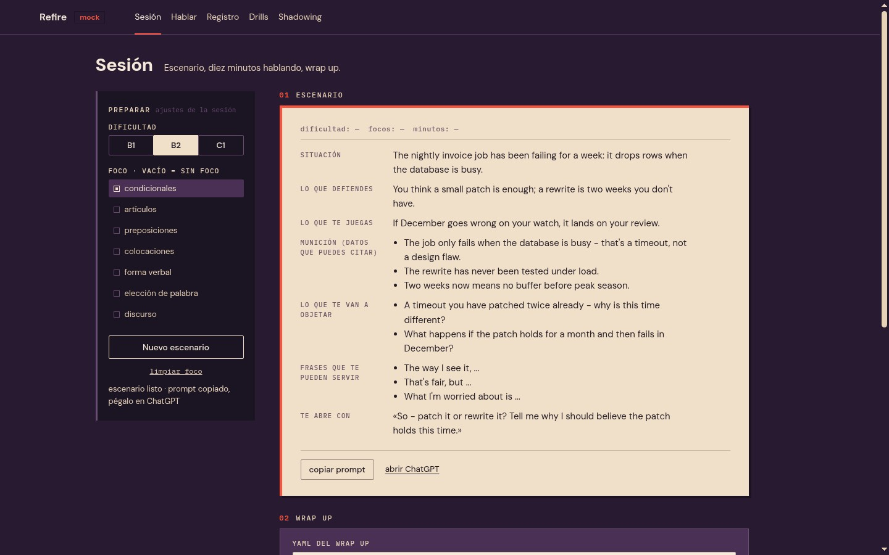
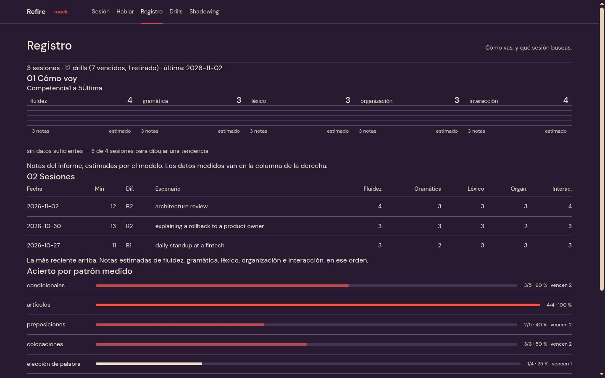
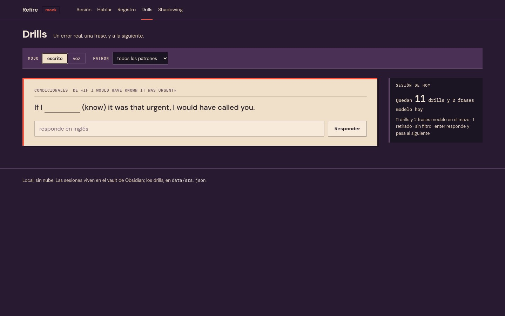
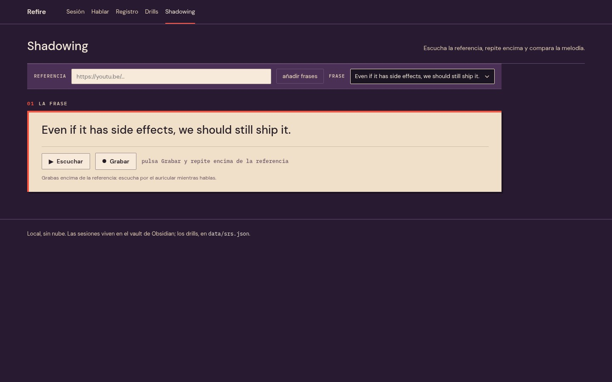

# Refire

App local para practicar inglés hablado: lanza un role-play por voz en ChatGPT, recoge el informe
del *wrap up*, lo guarda en una nota tipo Obsidian y genera drills (escritos y hablados) sobre los
errores reales de esa sesión.

El servidor es Python estándar, sin frameworks ni base de datos: `data/` y una nota en markdown.
Licencia MIT, ver [`LICENSE`](LICENSE). Las reglas de código del proyecto están en
[`AGENTS.md`](AGENTS.md).

## Arrancar

Tres comandos desde la raíz del repo, sin configurar nada más:

```bash
python3 -m venv .venv && .venv/bin/pip install -r requirements.txt   # voz y drills hablados
mkdir -p ~/.config/refire && cp voicekit.example.toml ~/.config/refire/voicekit.toml
REFIRE_DATA=$(mktemp -d) .venv/bin/python app.py                   # http://127.0.0.1:8770
```

Las dos primeras son opcionales. Con `python3 app.py` el servidor arranca igual y los drills se
quedan sin voz (`/api/drill/audio` responde 501). La pestaña Hablar pide algo más: el motor
`voicekit`, que no se distribuye con esta app, y un modelo Piper `.onnx` apuntado en el TOML. Sin
motor, `/api/talk/start` responde 503 `talk_unavailable` y el resto de la app funciona igual.
`ffmpeg` normaliza el audio a WAV mono 16 kHz antes de transcribir, así vale cualquier formato que
grabe el navegador y las pausas se pueden contar (PyAV no se usa).

Tampoco hace falta vault: `REFIRE_DATA` puede ser un directorio vacío. Los informes se guardan ahí
y la fila de la nota del registro solo se escribe si defines `REFIRE_VAULT`. El modelo se enchufa
con `REFIRE_AGENT_CMD` (ver «Enchufar un modelo»).

Para verlo poblado, con datos de ejemplo y sin llamar a nada: `http://127.0.0.1:8770/?mock=1`. Así
se ve el panel:









## Variables de entorno

| variable | efecto |
| --- | --- |
| `REFIRE_PORT` | puerto (por defecto 8770) |
| `REFIRE_HOST` | interfaz (por defecto 127.0.0.1) |
| `REFIRE_DATA` | directorio de datos (por defecto `./data`) |
| `REFIRE_VAULT` | ruta de la nota del registro (por defecto `<datos>/vault.md`) |
| `REFIRE_AGENT_CMD` | comando que consulta al modelo (ver «Enchufar un modelo») |
| `REFIRE_AGENT_FIXTURE` | ruta a un fichero: `call_agent` devuelve su contenido (tests) |
| `REFIRE_VOICEKIT` | TOML del motor de voz (por defecto `~/.config/refire/voicekit.toml`) |
| `REFIRE_SCENARIO_PROMPT` | prompt del escenario (por defecto `~/.config/refire/scenario.md`) |
| `REFIRE_SHADOW_PYTHON` | intérprete del analizador de shadowing (opcional) |
| `REFIRE_SHADOW_WORKER` | script del analizador de shadowing (opcional) |
| `REFIRE_YTDLP` | ruta alternativa a `yt-dlp` (tests / instalación en otro sitio) |

## Enchufar un modelo

La app no habla con ningún proveedor por su cuenta: todo pasa por
`lib/agent.py::call_agent(prompt)`, que ejecuta el comando de `REFIRE_AGENT_CMD` con un
timeout de 120 s. Si el comando lleva `{prompt}` se sustituye ahí; si no, el prompt va
como último argumento. Vale cualquier CLI que imprima la respuesta por la salida estándar:

```bash
export REFIRE_AGENT_CMD='llm -m gpt-5 {prompt}'
export REFIRE_AGENT_CMD='./mi-modelo.sh'     # recibe el prompt como último argumento
```

Las claves se leen sin pisar lo ya exportado de `~/.config/refire/env` y del `.env` del
repo; hay plantilla en `.env.example`. Sin `REFIRE_AGENT_CMD` la app arranca
igual: `/api/health` responde `"agent": "none"`, el escenario cae a la reserva local y el informe
se guarda con el aviso `drills_pending`.

## Tu prompt de escenario

El escenario se pide con `prompts/scenario.example.md`, que describe a un alumno genérico. El tuyo
—nivel, profesión, qué quieres practicar— vive en `~/.config/refire/scenario.md` y el repo no lo
versiona:

```bash
mkdir -p ~/.config/refire && cp prompts/scenario.example.md ~/.config/refire/scenario.md
$EDITOR ~/.config/refire/scenario.md
```

Si no hay prompt propio, la app usa el de ejemplo sin avisar. `REFIRE_SCENARIO_PROMPT` cambia esa
ruta.

## Qué modelo hace cada cosa

Cada pieza se elige en su sitio. Estas son las que usa esta instalación. La única excepción es la
transcripción de los drills: `lib/audio.py` la fija en `small`, CPU, `int8`.

| pieza | qué hace | dónde se elige | aquí |
| --- | --- | --- | --- |
| escenario y drills | inventa el role-play y saca las tarjetas del informe | `REFIRE_AGENT_CMD` (cualquier CLI) | `deepseek-v4.1-flash` en OpenCode Go |
| conversación de Hablar | contesta en el role-play por voz | `voicekit.toml`, `[llm]` `base_url` y `model` | `glm-5.3-flash` en OpenCode Go |
| transcripción de Hablar | pasa el turno a texto y cuenta pausas | `voicekit.toml`, `[stt] model` | `faster-whisper` `small` |
| voz | lee el turno en inglés | `voicekit.toml`, `[tts] voice` y `model_path` | Piper `en_GB-alba-medium` |
| análisis de shadowing | compara las curvas de melodía | `REFIRE_SHADOW_PYTHON` y `REFIRE_SHADOW_WORKER` | analizador externo con torch y librosa |
| frases de YouTube | baja el tramo del que salen las frases | `REFIRE_YTDLP` | `yt-dlp` |

Cambiar de modelo es cambiar esa línea y reiniciar; el código no distingue proveedores.

## API

Todo JSON UTF-8. Errores: `{"ok": false, "error": "<código>", "detail": "..."}`.

| método | ruta | qué hace |
| --- | --- | --- |
| GET | `/api/state` | sesiones (tabla del vault), patrones, contadores de drills, stats |
| POST | `/api/scenario` | `{difficulty, focus[], minutes}` → escenario + `block_b` listo para pegar |
| POST | `/api/report` | `{raw}` → fila en el vault + drills (409 duplicado, 422 YAML roto) |
| POST | `/api/report/{date}/drills` | regenera los drills de un informe ya guardado |
| POST | `/api/drill/answer` | `{id, correct}` → item actualizado |
| POST | `/api/drill/audio` | multipart `id` + `file`; 501 si no hay faster-whisper |
| GET | `/api/drills` | items del mazo; `?pattern=`, `?due=1`, `?all=1` |
| GET | `/api/export` | descarga la nota del vault en markdown; 409 `vault_missing` si no hay nota |
| GET | `/api/health` | latido y modo de agente (`cmd` / `fixture` / `none`) |
| GET | `/api/shadow/phrases` | banco de frases de shadowing con su referencia |
| POST | `/api/shadow/ingest` | `{url, inicio?, fin?}` → `{ok, id}`; baja, transcribe y añade frases en un hilo |
| GET | `/api/shadow/ingest/{id}` | `{status, paso, añadidas, candidatas}` de la ingesta |
| POST | `/api/shadow/forget` | `{pid}` → quita la frase del banco y borra su WAV |
| POST | `/api/shadow` | multipart `pid` + `file` (o binario con `?pid=`): guarda la toma y la analiza |
| GET | `/api/shadow/{id}` | estado (`pendiente`/`listo`/`error`) y curvas |
| POST | `/api/shadow/{id}/retry` | relanza el análisis de una toma guardada |
| GET | `/media/shadow/{id}` | la toma en WAV 16 kHz mono |
| GET | `/media/shadow/ref/{pid}` | la referencia de la frase |
| POST | `/api/shadow/word` | multipart `word` → audio de una palabra con la voz del TTS |
| GET | `/media/shadow/word/{word}` | ese audio cacheado |
| POST | `/api/talk/start` | abre una sesión de voz; 409 `talk_busy`, 503 `talk_unavailable` |
| POST | `/api/talk/turn` | multipart `file` → turno: transcripción, respuesta y voz |
| POST | `/api/talk/end` | cierra la sesión y devuelve el informe |
| GET | `/api/talk/events?since=N` | instantánea de eventos de la sesión de voz |
| GET | `/api/tts` | `?text=` → WAV leído en inglés |

`static/` se sirve tal cual si existe (`/`, `/app.js`, `/static/…`). Sin `static/index.html`,
`GET /` devuelve 404 y la API sigue funcionando.

## Cómo funciona una sesión

1. `POST /api/scenario` → pides escenario y `block_b`. Se copia en ChatGPT y se habla por voz.
2. Al terminar dices *wrap up* y pegas el informe en la app → `POST /api/report`.
   - Se parsea el YAML (bloque `session:` aunque venga con texto alrededor).
   - Se guarda respaldo en `data/reports/<fecha>-raw.txt` y `data/reports/<fecha>.json`.
   - Se añade **una** fila al final de la tabla de `## Registro de sesiones`; el resto de la
     nota queda byte a byte igual.
   - Se piden drills al modelo configurado (`prompts/analyze.md`) y se fusionan en `data/srs.json`.
3. La pestaña Drills sirve las tarjetas que tocan hoy.

## Estructura

```
app.py                 servidor HTTP (http.server, ThreadingHTTPServer) y rutas
lib/config.py          rutas y variables de entorno
lib/agent.py           call_agent(): el comando configurado / fixture; extract_json()
lib/session.py         pipeline del informe, estado, escenario, export, /api/drills
lib/vault.py           tabla del registro: parsear y añadir UNA fila
lib/yamlmini.py        parser YAML mínimo (solo stdlib)
lib/text.py            comparación tolerante (contracciones, puntuación)
lib/patterns.py        enum cerrado de patrones
lib/srs.py             mazo, repetición espaciada, agregados por patrón
lib/audio.py           multipart + faster-whisper opcional + pausas en WAV
lib/shadow.py          banco de frases, tomas y llamada al analizador (curvas)
lib/shadow_ingest.py   segmentación, filtro de calidad/deduplicado y banco (puro, con tests)
lib/shadow_youtube.py  descarga con yt-dlp + trabajo de ingesta en segundo plano
prompts/               scenario.example.md (la plantilla), blockB.md, analyze.md, wrapup.md
tests/                 unittest + fixtures (ningún test llama al modelo ni a la red)
data/                  srs.json, reports/ (se crea solo)
```

## Tests

```bash
python3 -m unittest discover -s tests -v
```

No llaman al modelo: usan `REFIRE_AGENT_FIXTURE` sobre `tests/fixtures/agent-*.json`
y un vault temporal. `tests/test_api.py` arranca el servidor de verdad en un puerto libre.

Sin el venv se saltan 31 tests de `test_talk`, porque necesitan el motor `voicekit`, que no se
distribuye. Con el venv corre todo menos uno.

## Datos

- `data/srs.json` — mazo y agregados por patrón (escritura atómica: `.tmp` + `os.replace`).
- `data/reports/<fecha>.json` — informe parseado + hash del texto pegado.
- `data/reports/<fecha>-raw.txt` — lo pegado, tal cual.
- `data/reports/<YYYY-MM-DD-HHMM>-raw.txt` — texto crudo de un informe que no parseó (422).
- `data/shadow/phrases.json` — banco de frases: es texto propio y viaja en el repo. La ingesta de
  YouTube escribe en este mismo fichero, así que si publicas tu copia, no dejes que se cuele texto
  de fuera: `tests/test_repo_hygiene.py` falla si una frase trae `source`, `license` o `speaker`.
- `data/shadow/refs/<pid>.wav` — audio de referencia de cada frase. Es audio: se queda en el
  equipo de cada uno y no se versiona, así que un clon nuevo trae el texto y no el sonido.
- `data/shadow/audio/<id>.wav` y `data/shadow/takes.json` — tomas y sus metadatos (se ignoran en git).
- `data/shadow/downloads/` — audio temporal de `yt-dlp`; se borra al terminar cada ingesta (ignorado).
- `data/shadow/candidates/` — cortes de trabajo de una ingesta (ignorado).

Nada escribe fuera de `data/` y de la nota del registro.

## Shadowing

La cuarta pestaña escucha una frase del banco, graba encima y superpone las dos curvas de melodía.
No hay nota, ni rango en semitonos, ni ritmo: solo la forma de la línea. El análisis se delega a
un analizador externo (`worker.py` con su propio venv, tipo torch + librosa) por subproceso, una
línea JSON de entrada y una de salida; se configura con `REFIRE_SHADOW_PYTHON` y
`REFIRE_SHADOW_WORKER`. Si no está o no existe, `/api/shadow` responde 503 `shadow_unavailable`,
la toma queda guardada con error y la app sigue funcionando. Timeout 60 s y un reintento como
mucho.

El banco viaja como texto: un clon limpio trae cuatro frases sin audio de referencia, y hay que
dárselo grabándolas o con la ingesta de abajo.

Arriba de la pestaña hay una fila discreta para pegar un enlace de YouTube: `POST
/api/shadow/ingest` baja solo el tramo indicado (por defecto del minuto 1 al 6), lo transcribe con
faster-whisper y añade solas las frases de 2–8 s, ≥ 4 palabras, confianza ≥ 0,80 y que no estén ya
en el banco (máximo 20 por vídeo). Cada candidata lleva un botón `quitar`. El servidor necesita
`.venv/bin/python app.py`, `ffmpeg` y `yt-dlp` (en el `PATH` o donde diga `REFIRE_YTDLP`); si falta
`yt-dlp`, la pestaña lo dice en una línea y el banco anterior sigue usable.

Lo que ingieras corre en tu máquina y es cosa tuya: el repo no trae ni audio ni texto de YouTube. Si
publicas tu copia, deja fuera del banco las frases que vengan de un vídeo; `tests/test_repo_hygiene.py`
falla si las hay.
